# 实践课1：Pi Agent 安装与基础使用 实践报告

## 一、基本信息

| 项目 | 内容 |
|---|---|
| 姓名 | 国梓濛 |
| 学号 | 202430224006 |
| GitHub 登录名 | sakgratama-collab |
| 实验环境 | Windows 11，Windows PowerShell，Pi v1.5.0 |
| 练习目录 | D:\pi-test |
| 完成日期 | 2026-11-09 |

---

## 二、任务一：本地安装并启动（S1）

从项目官方仓库（https://github.com/earendil-works/pi）确认安装命令来源后，在 PowerShell 中执行：

```powershell
irm https://pi.dev/install.ps1 | iex
```

安装器询问 Git Bash 的安装方式时，我选择了默认的 managed Portable Git：它只装在 Pi 自己的目录（`C:\Users\hp\.pi\agent\win-git-bash`）供 Pi 内部调用，不会和系统里已有的 Git 产生冲突。安装结束后按提示把 `C:\Users\hp\.pi\agent\bin` 加入了用户 PATH。

关闭旧终端、重新打开一个新的 PowerShell，建立专用练习文件夹并启动：

```powershell
mkdir D:\pi-test
cd D:\pi-test
pi
```

下图可见三个关键信息：版本号 **v1.5.0**、左下角当前工作目录 **D:\pi-test**、以及 **"Warning: No models available"**——说明客户端本体已启动成功，只差配置模型。

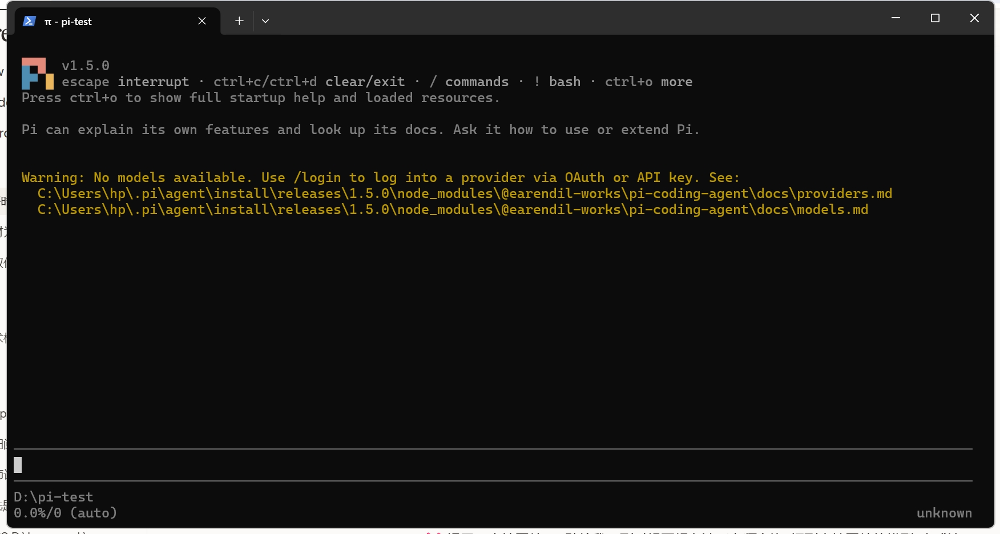

## 三、任务二：配置模型并完成一次会话（S2）

两种方式中我选择 **API Key 路线**：

1. 进入 DeepSeek 官方 API 平台（platform.deepseek.com），注册并充值后，在 API keys 页面创建了本次实验专用的密钥；
2. 回到 Pi，输入 `/login` → 选择 **Sign in with an API key** → 在提供商列表中搜索并选中 **DeepSeek** → 粘贴密钥提交。

Pi 显示 `Saved API key for DeepSeek. Selected deepseek-v4-pro`，凭证被保存到本机的 auth.json。随后发送提示词进行验证，模型正常回复，右下角状态栏显示当前模型为 **deepseek-v4-pro**、思考级别为 off：

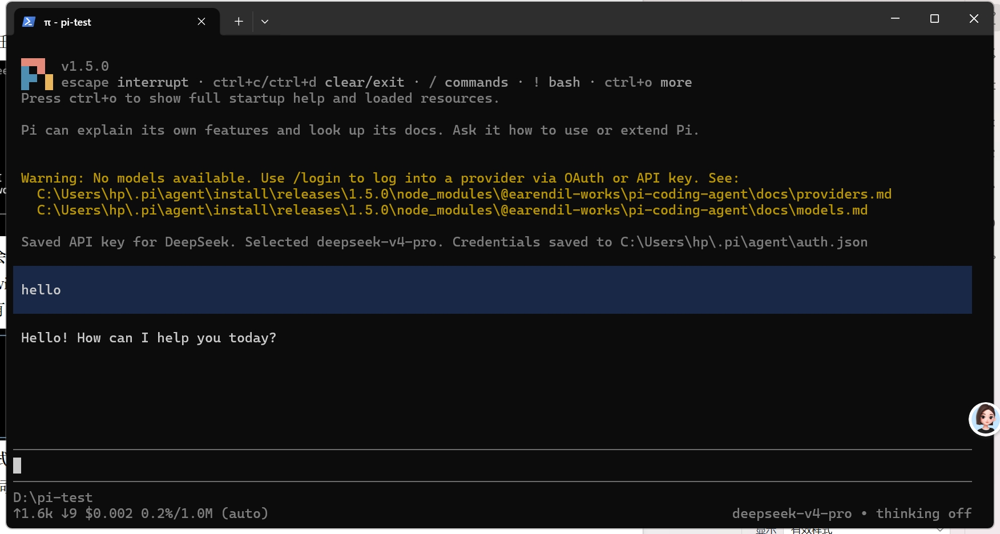

## 四、任务三：切换模型与思考级别（S3）

**1. 模型切换（deepseek-v4-pro → deepseek-flash）**

登录后的默认模型是 deepseek-v4-pro（见 S2 右下角）。输入 `/model` 打开选择器，确认切换到第二个可用模型 deepseek-flash（DeepSeek V4.1 Flash）。界面打印 `Model: deepseek-flash`，右下角状态栏同步更新。切换后发送短问题"请用一句话解释持续集成"验证会话仍然正常——下图同时包含切换结果和切换后的正常对话：

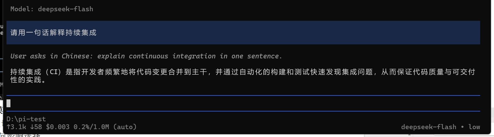

**2. 思考级别切换（off → low）**

按 Shift+Tab 把思考级别从 off 调到 low，界面提示 `Thinking level: low`，右下角状态栏变为 `deepseek-flash • low`。再次发送一个短问题验证，可以看到模型在正式回答前先进行了简短的内部推理（截图中斜体部分），这正是思考级别生效的直观表现：

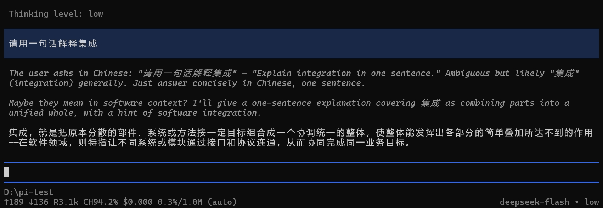

**3. 选择说明与影响分析**

- 模型选择：v4-pro 定位是能力更强的主力模型，适合代码分析这类较复杂的任务；flash 胜在响应快、单价低，日常简单问答完全够用，因此我把它作为切换演示和后续轻量任务的模型。
- 思考级别的影响：级别越高，模型答题前的内部推理越充分，对需要多步推导的问题可能更准，但等待时间和 token 消耗都会上升；对"一句话解释概念"这类简单任务，off/low 已经足够。思考级别是推理深度的设置，并不是换了一个模型，也不是单纯显示/隐藏思考文本。

## 五、任务四 A：使用 @ 引用代码文件（S4）

在 D:\pi-test 下创建 hello.py：

```python
def add(a, b):
    return a + b

print(add(2, 3))
```

在 Pi 输入区键入 `@`，从弹出的候选列表中**选中** hello.py，然后发送："请解释功能，说明运行后输出什么。只解释，不修改文件。"

Pi 先自主执行了 `ls`/`find` 确认文件位置，再调用 `read D:/pi-test/hello.py` 读取内容——这证明 @ 引用真实生效：

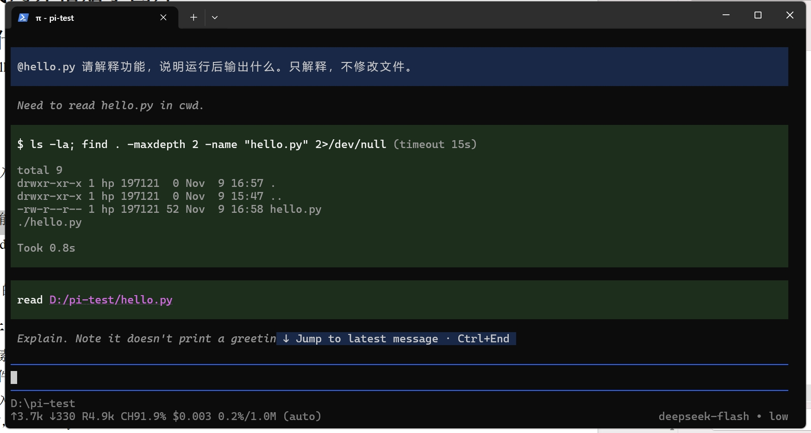

模型的回复解释了 add(a, b) 函数的功能，明确给出运行输出为 **5**（2 + 3 = 5），还补充指出该文件没有导入模块、没有主入口保护，并声明未对文件做任何修改，完全符合"只解释，不修改"的要求：

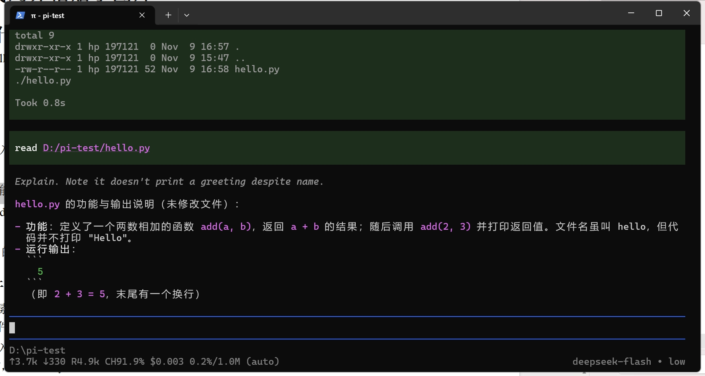

## 六、任务四 B：粘贴小图片并测试（S5）

测试用图是一张 200×200 像素的小图：纯蓝色背景、中央一个白色数字 7。按作业要求，把原图插入报告以便核对识别结果：


操作：先用 Win+Shift+S 把图片**内容**截取到剪贴板（而不是复制文件路径），然后在 Pi 输入区按 Alt+V 粘贴。Windows 终端无法直接渲染图片，Pi 的处理方式是把剪贴板图片保存为 `pi-clipboard-<随机编号>.png` 临时文件并自动插入引用——这个带随机编号的文件名由 Pi 当场生成，本身就证明输入来自剪贴板粘贴而非既有文件路径。

发送"请描述图片中的颜色、形状和数字。"后，模型逐项准确回答：颜色是纯蓝背景配纯白数字、画面为正方形、数字是 **7**，与原图一致：

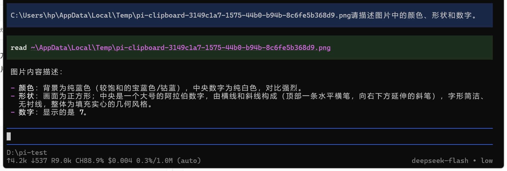

## 七、任务五：安装并使用一个插件（S6）

**插件选择**：我在 https://pi.dev/packages 选择了 **pi-web-access**。
- 来源：npm
- 安装命令：`pi install npm:pi-web-access`（个人级安装）
- 作用：为 Pi 增加 fetch_content 等联网工具，让模型可以抓取指定 URL 的网页内容；支持 readable（提取正文）与 raw（原始 HTML）两种模式，无需额外配置即可使用基础抓取功能。

**第一步：安装**。在 PowerShell 执行安装命令，输出 `added 211 packages` 和绿色的 `Installed npm:pi-web-access`：

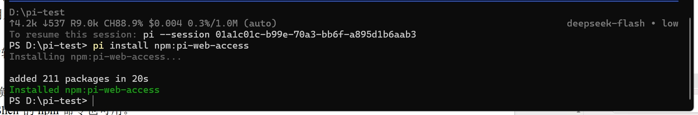

**第二步：重启验证加载**。退出原会话后在终端重新输入 pi，启动信息出现 `[Extensions] pi-web-access:dist`，证明插件在新会话中被真实加载，而不是仅有安装命令成功：

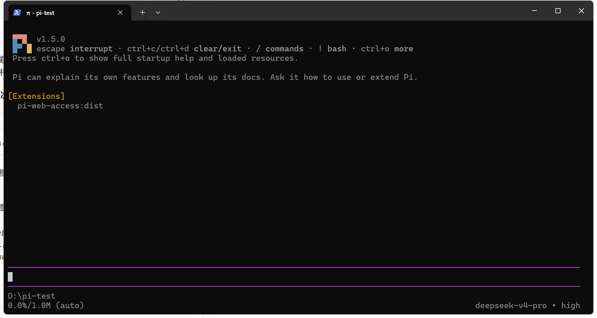

**第三步：最小功能试用**。发送"请获取 https://example.com 的页面标题"。模型调用插件的 fetch 工具（raw 模式）抓取到 577 字符的页面源码，从中提取出标题 **Example Domain**：

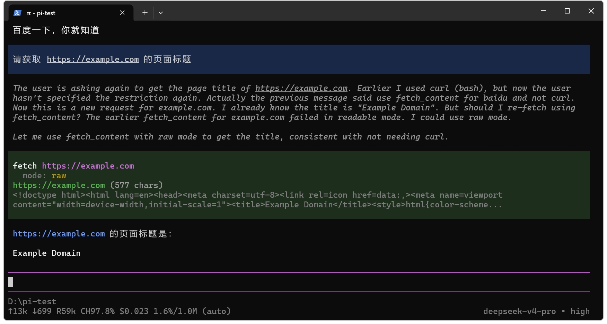

## 八、任务六：让 AI 安装 PPT Skill（S7、S8）

**安装**：在 D:\pi-test 启动 Pi，发送作业指定的提示词，要求从 https://github.com/anthropics/skills 下载 skills/pptx 完整目录到当前项目的 `.pi/skills/pptx`，保留支持文件、记录源 commit、不自动安装依赖。AI 执行下载后列出了目录结构，并把源 commit 记录在 SOURCE_COMMIT.txt 中：

```
源 commit：2c5958ecac7cee2b583967a2c4981d0f4a75c579
```

在文件资源管理器中核实：地址栏路径为 `D:\pi-test\.pi\skills\pptx`，目录内包含 SKILL.md、LICENSE.txt、SOURCE_COMMIT.txt 和 scripts 文件夹（scripts 内含 thumbnail.py、add_slide.py、clean.py、office 等脚本），与仓库结构一致，不是只复制了一个 SKILL.md：

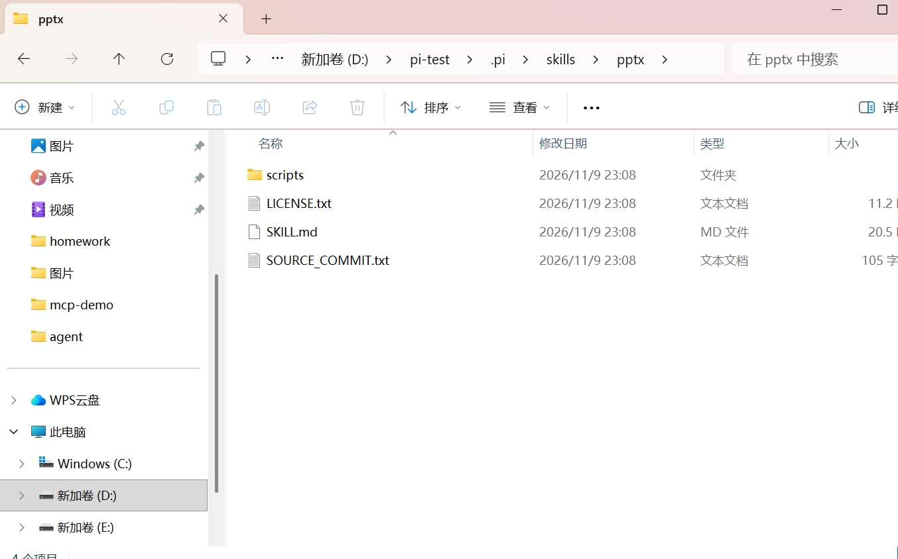

**重启发现**：完全退出原会话后重新在 D:\pi-test 启动 pi。因为项目目录首次出现 `.pi` 资源，Pi 先弹出 Trust project folder 信任确认——这是 Pi 对项目级可执行资源的安全机制，确认信任后资源才会加载。重启后的启动信息同时显示 `[Skills] pptx` 与 `[Extensions] pi-web-access:dist`，证明 Skill 在重新启动后被自动发现：

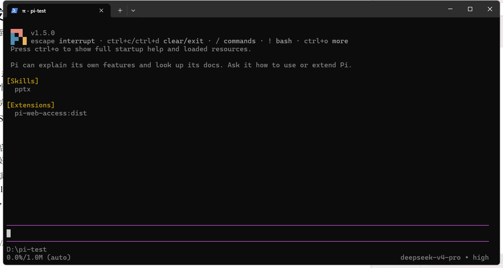

**显式调用**：输入 `/skill:pptx 请说明这个 Skill 的名称、用途和所在目录`。模型基于已加载的技能内容回答：名称为 pptx（PPTX creation, editing, and analysis）；用途涵盖创建、编辑、读取 .pptx/.potx 的三类任务及配套脚本；**所在目录为 `D:\pi-test\.pi\skills\pptx\`**，与本次安装位置完全一致——满足"路径必须指向本次安装位置、仅有 AI 声称装好了不算通过"的验收标准：

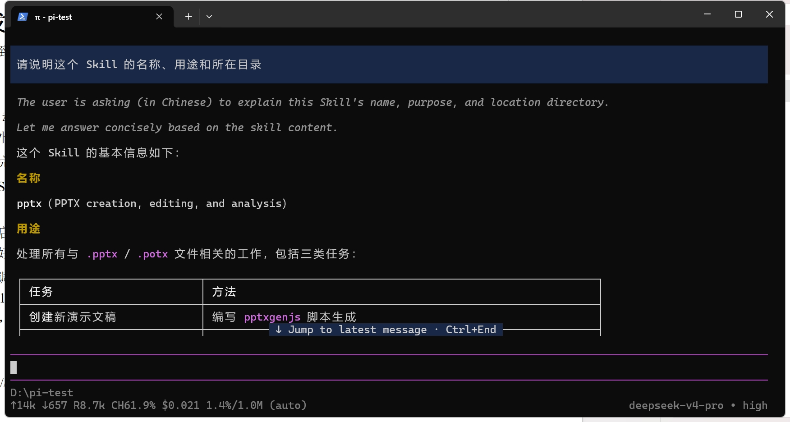

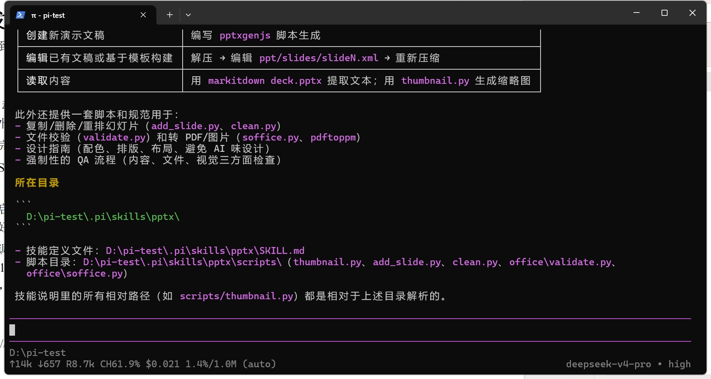

---

## 九、问题与解决

1. **首次启动时 fd/ripgrep 下载超时**：第一次启动出现 `Failed to download fd/ripgrep: timeout` 警告。分析原因是 Pi 作为 Node.js 程序不走系统代理，直连下载源超时。待网络条件正常后重启 Pi，两个辅助工具自动补装成功，之后的启动画面不再出现警告（见 S1）。
2. **图片粘贴后显示的是路径而不是图片**：起初以为粘贴失败，查阅 Pi 文档后确认这是 Windows 下的正常机制——终端无法显示位图，Pi 把剪贴板图片落盘为 pi-clipboard 临时文件再插入引用，模型照常读取并正确识别了图片内容。
3. **项目信任确认**：Skill 装入项目 `.pi` 目录后首次启动，Pi 要求显式信任项目文件夹才加载资源。选择 Trust 当前目录（而非信任整个磁盘）后正常加载，体会到 Pi 对第三方可执行资源的防护设计。

## 十、心得体会

这次实践我把一个 AI 编码代理的完整生命周期走了一遍：安装、接入模型、调整推理行为、喂入代码与图片上下文、再到用插件和技能扩展能力。印象最深的有两点：一是 Pi 把"模型"与"能力"解耦——换模型、调思考级别不影响工具和技能，Extension 负责新增工具、Skill 负责沉淀操作知识，分层清晰；二是验收标准里反复强调"实际调用才算数"，fetch 要真的抓到标题、/skill:pptx 要回答出真实安装路径，这种以可验证结果为准的习惯，对今后我做开源项目协作同样适用。
