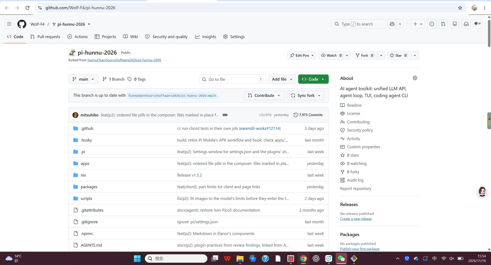
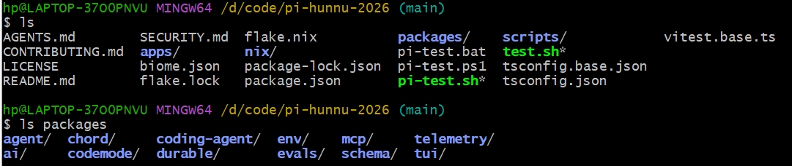
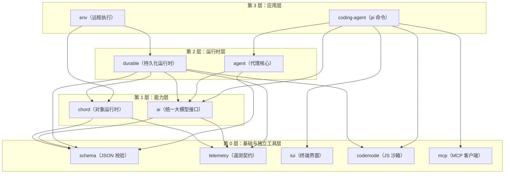

# 实践课2：组织建仓与源码分析实践报告

## 基本信息

| 项目 | 内容 |
|---|---|
| 姓名 | 国梓濛 |
| 学号 | 202430224006 |
| GitHub 登录名 | sakgratama-collab |
| 所在小组 | 第 13 组（组织：Wolf-F4） |
| 分析所用提交 | `c3cc91632d0a1950fb122605b190233f2aa0006e` |

---

## 一、小组组织仓库（任务一）

本组的小组代码仓库由组长从课程仓库 fork 建立：

- 小组组织：`Wolf-F4`
- 小组仓库：https://github.com/Wolf-F4/pi-hunnu-2026
- fork 来源：`hunnuOpenSourceSoftware2026/pi-hunnu-2026`（课程仓库），仓库页面标题下方显示 "forked from hunnuOpenSourceSoftware2026/pi-hunnu-2026"
- 全体组员均已加入 Wolf-F4 组织，具有仓库访问权限

组织仓库页面截图：


## 二、源码获取（任务二）

### 2.1 下载源码

在 `D:\code` 下执行（Git Bash）：

```bash
git clone --branch main https://github.com/Wolf-F4/pi-hunnu-2026.git
cd pi-hunnu-2026
```

实际 clone 地址（文本）：**https://github.com/Wolf-F4/pi-hunnu-2026.git**

### 2.2 确认源码来源和版本

依次执行确认命令，结果如下：

| 命令 | 实际输出 | 结论 |
|---|---|---|
| `pwd` | `/d/code/pi-hunnu-2026` | 源码已在本地 |
| `git remote -v` | `origin https://github.com/Wolf-F4/pi-hunnu-2026.git`（fetch/push 两行） | origin 指向小组组织仓库 |
| `git branch --show-current` | `main` | 当前分支为 main |
| `git rev-parse HEAD` | `c3cc91632d0a1950fb122605b190233f2aa0006e` | 与课程仓库 main 一致 |
| `git status --short` | （无输出） | 工作区干净 |

截图 S1（当前目录、远端地址、分支与提交编号）：



源码目录结构截图：



## 三、构建体系总览

仓库根目录的 `package.json` 表明这是一个 npm monorepo（`name: pi-monorepo`），通过 `workspaces` 把 `packages/*`、`apps/*` 等目录统一管理。根目录的 `build` 脚本没有使用 `--workspaces` 批量执行，而是**显式地按固定顺序逐个进入模块目录执行各自的 build**：

```
telemetry → schema → chord → tui → codemode → mcp → ai → durable → env → agent → coding-agent
```

## 四、模块分析表（任务三）

| 子文件夹 | 代码主要实现什么功能 | 本模块 build 执行什么、生成什么 | 直接依赖哪些内部模块 | 依据文件或代码位置 |
|---|---|---|---|---|
| `telemetry` | 与厂商无关的遥测契约和带类型的模式工具，为全家族提供统一的观测数据格式 | `tsc -p tsconfig.build.json`，把 `src/` 编译为 `dist/` 下的 JS 与类型声明 | 无（最底层） | `packages/telemetry/package.json`、`tsconfig.build.json`（rootDir=src，outDir=dist） |
| `schema` | JSON Schema 校验库（支持 draft 2020-12 与 draft 7），特点是把校验编译成普通代码、不使用 eval | 同上，`tsc` 编译生成 `dist/` | 无（最底层） | `packages/schema/package.json` |
| `chord` | 跨进程应用的对象运行时：契约、文档、存储与链接，是多进程间共享状态的基础设施 | `tsc` 编译生成 `dist/` | `schema`、`telemetry` | `packages/chord/package.json` 的 dependencies |
| `tui` | 终端用户界面库，采用差分渲染提高文本界面效率（Pi 的聊天界面即由它绘制） | `tsc` 编译生成 `dist/`；另有 `build:native:*` 为三种操作系统编译原生组件 | 无内部依赖（仅第三方库，如 marked） | `packages/tui/package.json`；根 package.json 的 `build:native:win32` 等脚本 |
| `codemode` | 沙箱化的 JavaScript 执行环境（基于 quickjs-wasi），沙箱内唯一的能力是调用被注入的工具 | `tsc` 编译生成 `dist/` | 无内部依赖 | `packages/codemode/package.json` |
| `mcp` | 独立的 MCP（Model Context Protocol，模型上下文协议）客户端，可被 pi 或其他应用使用 | `tsc` 编译生成 `dist/` | 无内部依赖 | `packages/mcp/package.json` |
| `ai` | 统一的大模型 API 层：把 Anthropic、OpenAI、Google、Bedrock 等厂商 SDK 封装成一个接口，并自动发现模型与配置供应商 | 两步：先 `generate-models`（运行 `catalog/generate.ts` 生成模型目录），再 `build:offline` 校验模型数据并 `tsc` 编译 | `schema`、`telemetry` | `packages/ai/package.json` 的 scripts 与 dependencies |
| `durable` | 持久化的会话、任务与文档运行时，让对话和任务状态可靠落盘（README 标注为实验性） | `tsc` 编译生成 `dist/` | `chord`、`ai`、`codemode`、`schema`、`telemetry`（内部依赖最多的模块） | `packages/durable/package.json` |
| `env` | 远程执行环境：通过 SSH 在远程机器部署一个小守护进程，让代理的工具在远端执行，而数据与凭据留在本地 | `tsc` 编译生成 `dist/`（守护进程本体在 `daemon/`，为 Rust 程序，不在本链条内） | `chord`、`durable` | `packages/env/package.json`、`packages/env/README.md` |
| `agent` | 通用代理核心（包名 `pi-agent-core`）：代理循环的状态管理、传输抽象与附件处理，不绑定具体场景 | `tsc` 编译生成 `dist/` | `ai`、`schema` | `packages/agent/package.json` |
| `coding-agent` | 编码代理 CLI，即 `pi` 命令本体：内置 read/bash/edit/write 等工具与会话管理 | 两步：`build:unbundled` 用 `tsc` 编译并设置 `dist/cli.js` 等为可执行；随后运行 `scripts/build-coding-agent-bundle.mjs`，用 esbuild 把 CLI 及依赖打成单文件 bundle，便于分发 | `agent`、`ai`、`codemode`、`mcp`、`tui` | `packages/coding-agent/package.json`、`scripts/build-coding-agent-bundle.mjs` |

## 五、模块层级与依赖关系图

下图使用 Mermaid 绘制（另附独立图源文件 [`deps.mmd`](deps.mmd)）。箭头方向统一为 **使用方 → 被依赖方**。



**层级划分依据**：按"只被别人依赖还是也依赖别人"分层。第 0 层五个模块的 `dependencies` 中都没有任何内部包（schema/telemetry 是被大量复用的基础契约，tui/codemode/mcp 是自成一体的独立工具）；第 1 层只依赖第 0 层；第 2 层开始组合第 0、1 层能力；第 3 层是面向用户/部署场景的最终产品。

**依赖口径说明**：图中所有箭头均来自各模块 package.json 的 dependencies 字段（运行时的直接依赖）；devDependencies属于开发期依赖，未画入图中。

## 六、三个问题的回答

**1. 根目录与子模块中的 `npm run build` 分别读取什么配置、执行什么工作？**

根目录的 `npm run build` 读取根 `package.json` 的 `build` 脚本。它不做编译本身，而是按固定顺序 `cd` 进 11 个模块目录，依次触发各模块自己的 `npm run build`。子模块的 build 读取的是**本模块**的 `package.json` 与 `tsconfig.build.json`（典型配置为 rootDir=`src`、outDir=`dist`），执行 `tsc` 把 TypeScript 编译成 `dist/` 下的 JavaScript 和类型声明文件。两个模块比较特殊：`ai` 在编译前先运行 `catalog/generate.ts` 生成模型目录数据；`coding-agent` 在 `tsc` 编译之后，还要运行仓库级脚本 `scripts/build-coding-agent-bundle.mjs`，用 esbuild 把 CLI 入口连同依赖打包成单文件 bundle 并赋予可执行权限。

**2. 构建顺序和模块依赖有什么关系？相邻构建的模块是否一定互相依赖？**

构建顺序是依赖关系的**拓扑排序**：任何模块构建时，它 `dependencies` 里的内部包必须已经编译出 `dist/`，所以被依赖者永远排在前面,没有内部依赖的 telemetry、schema 最先，依赖最多的 coding-agent 最后。但**相邻不等于依赖**：例如 `tui` 紧跟在 `chord` 之后构建，而 `tui` 的 dependencies 里完全没有 chord；`mcp` 排在 `codemode` 之后，两者也互不依赖。拓扑排序只约束"依赖必须在前"，互不依赖的同层模块之间先后次序是任意的，这几对相邻模块恰好证明了这一点。

**3. 选择一条涉及至少三个模块的依赖路径，说明这些模块如何分工。**

我选择自己重点分析的主线路径：**coding-agent → agent → ai → schema**（四个模块、三级依赖）。分工像一条流水线：`schema` 在最底层负责 JSON Schema 校验，保证工具参数、配置与模型返回的结构化数据都合法；`ai` 在其上把各家大模型厂商的 API 统一成一个接口，并自动发现可用模型（我配置 DeepSeek 时用到的模型目录就来自这里）；`agent` 利用 ai 提供的模型能力实现与场景无关的通用代理循环——状态管理、传输抽象、附件处理；最顶层的 `coding-agent` 把通用代理特化为"编码代理"：注入 read/bash/edit/write 等编程工具、管理会话，并通过 tui 呈现终端界面，最终成为用户手里的 `pi` 命令。这条路径体现了"底层定契约、中层给能力、上层做产品"的分层思想。

## 七、本人重点分析的模块：coding-agent

我重点阅读了 `packages/coding-agent`，因为它就是实践课 1 里我使用的 `pi` 命令本体，读它能把"用过的功能"和"背后的代码"对上号。

- **入口简单**：`src/cli.ts` 只有几行——`setupCli()` 之后把命令行参数交给 `main.ts`，真正的逻辑都在 `src/cli/`、`src/core/`、`src/modes/` 等目录里分层展开。
- **内置工具在 `src/core/tools/`**：能看到 `bash.ts`、`read.ts`、`edit.ts`、`write.ts`、`grep.ts`、`find.ts`、`ls.ts` 等文件，与官方介绍的"read, bash, edit, write 工具"一一对应；目录里还有 `powershell.ts`，说明对 Windows 终端做了专门支持，这解释了我在 Windows 上使用时命令执行顺畅的原因。
- **会话与配置在 `src/core/`**：`agent-session.ts`、`agent-session-runtime.ts` 负责会话的建立与运行；`auth-storage.ts` 管理登录凭据（实践课 1 中 `/login` 写入的 auth.json 即与此相关）；`model-registry.ts`、`model-config.ts` 对应 `/model` 切换模型的能力；`keybindings.ts` 管理快捷键。
- **扩展机制在 `src/extensions/`**：内含 `mcp`、`codemode`、`tool-search` 等子目录，是插件（如我在实践课 1 安装的 pi-web-access）得以挂载的机制所在。
- **构建最特殊**：它是唯一"编译 + 打包"两段式构建的模块——先 `tsc` 编译出 `dist/`，再用 esbuild 产出单文件 bundle。我的理解是：作为要通过 npm 分发给最终用户的 CLI，打成自包含的单文件可以减少安装体积与依赖解析问题，这与其余十个"库"性质的模块只出 `dist/` 形成了鲜明对比。

## 九、心得体会

这次作业最大的收获是学会了"从构建脚本反推架构"：根 package.json 里那条很长的 build 命令，初看只是一串重复的 cd 和 npm run build，但把每个模块的 dependencies 摆在一起后，就能发现它正是依赖关系的拓扑排序，顺着它读等于拿到了官方亲手画的分层图。另外，对比 coding-agent 与其他模块构建方式的差异，也让我体会到"库"与"最终产品"在工程处理上的不同取舍。
