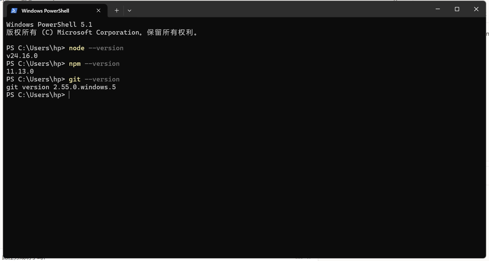
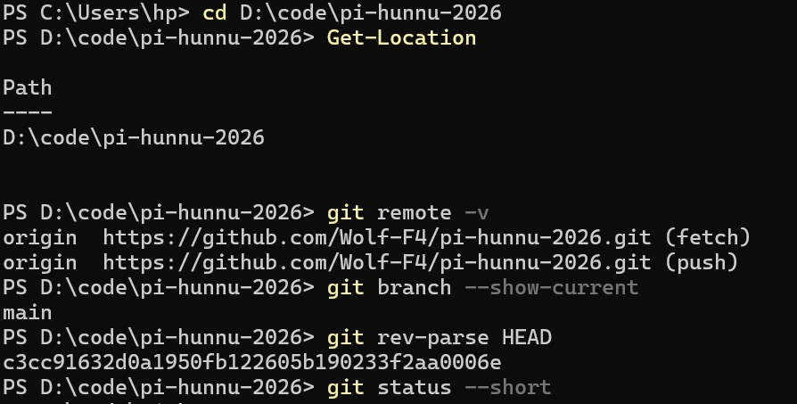
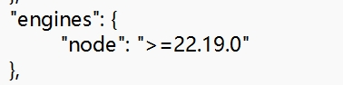
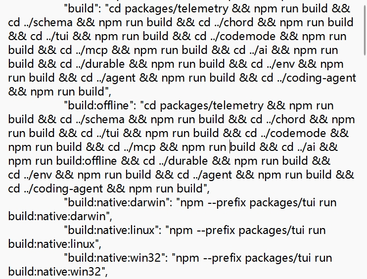
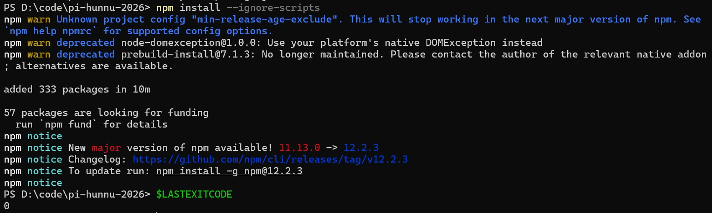
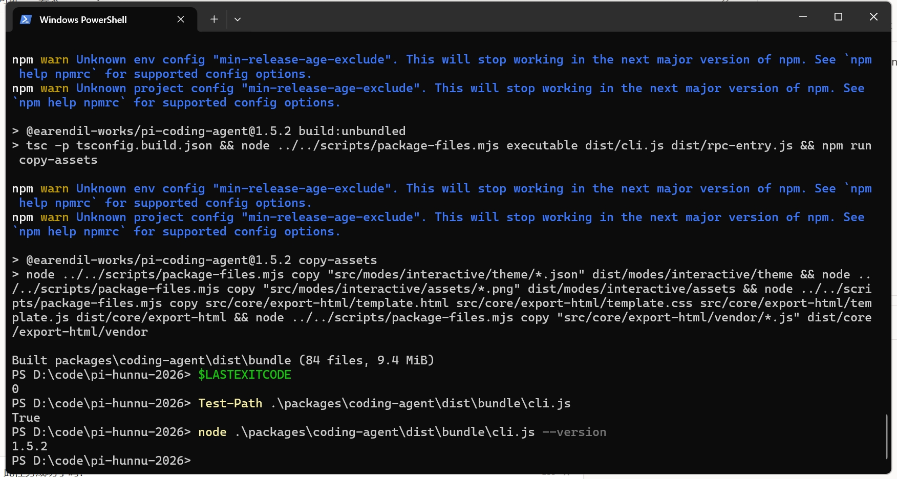
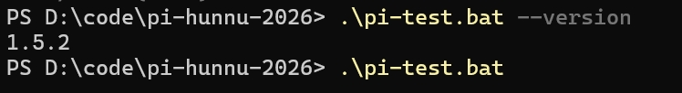
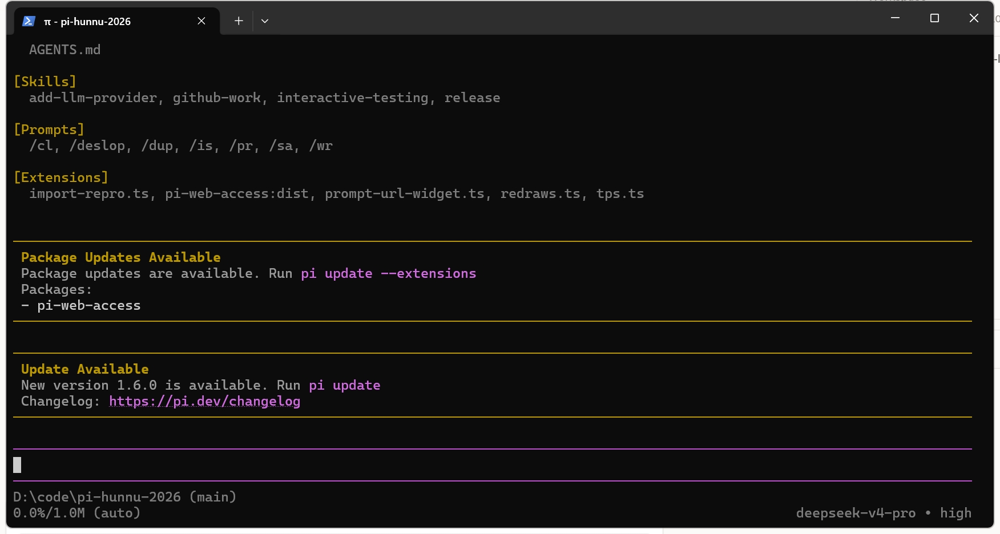
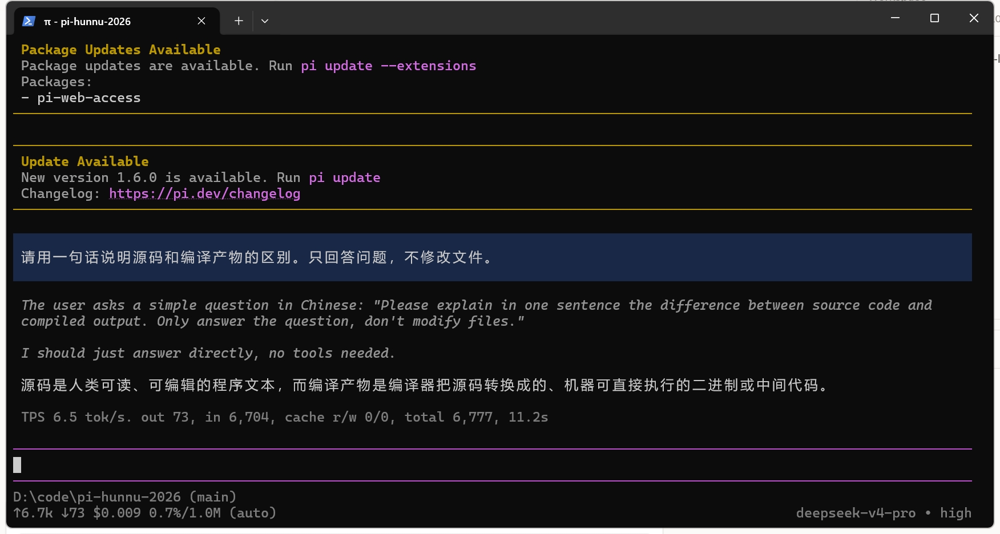

# 实践课3：Pi Agent 源码安装与编译实践报告

## 基本信息

| 项目 | 内容 |
|---|---|
| 姓名 | 国梓濛 |
| 学号 | 202430224006 |
| GitHub 登录名 | sakgratama-collab |
| 所在小组 | 第 13 组（组织：Wolf-F4） |
| 源码仓库 | https://github.com/Wolf-F4/pi-hunnu-2026 （小组组织内 fork） |
| 构建所用提交 | `c3cc91632d0a1950fb122605b190233f2aa0006e` |

---

## 一、任务一：开发工具检查（S1）

在 PowerShell 中逐条检查三个工具：

| 工具 | 实际版本 | 对照要求 |
|---|---|---|
| Node.js | v24.16.0 | 满足根项目 `engines` 声明的 `>=22.19.0`，同时符合"建议使用 Node.js 24 LTS"的统一环境建议 |
| npm | 11.13.0 | 随本机 Node.js 附带 |
| Git | 2.55.0.windows.5 | 可正常执行 `git --version` |



## 二、任务二：源码获取确认（S2）

源码在实践课 2 已从小组组织仓库 clone 至本地 `D:\code\pi-hunnu-2026`：

| 命令 | 实际结果 | 说明 |
|---|---|---|
| `Get-Location` | `D:\code\pi-hunnu-2026` | 源码位置 |
| `git remote -v` | `origin https://github.com/Wolf-F4/pi-hunnu-2026.git` | origin 指向小组组织内 fork |
| `git branch --show-current` | `main` | 当前分支 |
| `git rev-parse HEAD` | `c3cc91632d0a1950fb122605b190233f2aa0006e` | 完整提交编号 |
| `git status --short` | （无输出） | 工作区干净 |



后续所有安装与构建命令均在该仓库根目录执行。

## 三、任务三：阅读配置，确认安装与编译依据（S3）

用编辑器打开根目录 `package.json`，确认两处关键配置：

**（1）engines 字段** —— Node.js 版本要求的出处：

```json
"engines": {
    "node": ">=22.19.0"
}
```



**（2）scripts.build 字段** —— 一条用 `&&` 串联的长命令，依次进入 `packages/` 下的 telemetry、schema、chord、tui、codemode、mcp、ai、durable、env、agent、coding-agent 共 11 个子包，逐个执行该子包自己的 `npm run build`；`&&` 保证前一步成功才继续下一步：



**回答作业问题：**

- *Node.js 版本要求在哪里？* 在仓库根目录 `package.json` 的 `engines.node` 字段，值为 `>=22.19.0`。它声明的是根项目的最低要求；个别工作区依赖可能要求更高版本。
- *`npm run build` 实际从哪里读取命令？* 从当前目录 `package.json` 的 `scripts.build` 字段读取。在根目录执行时读到的是上面那条"逐包构建"的长命令；进入某个子包目录执行时，读到的则是该子包自己的构建命令（多数是 `tsc -p tsconfig.build.json`）。也就是说 build 做什么完全由项目配置决定，npm 并没有一套对所有项目通用的编译过程。

## 四、任务四：安装项目依赖（S4）

在仓库根目录执行：

```powershell
npm install --ignore-scripts
```

这条命令做的事：按 `package.json` 与 `package-lock.json` 的锁定版本解析并下载全部依赖，在项目内建立 `node_modules` 目录（位于 `D:\code\pi-hunnu-2026` 内），同时把 workspaces 中的本地子包相互关联；`--ignore-scripts` 跳过安装阶段自动触发的生命周期脚本（如 `prepare`）。

**实际结果**：`added 333 packages in 10m`，随后 `$LASTEXITCODE` 为 `0`，安装成功。



**对输出中警告的区分**（没有任何 `npm error`，以下均不是失败）：

| 输出 | 性质 | 分析 |
|---|---|---|
| `npm warn Unknown project config "min-release-age-exclude"` | 警告 | 项目 `.npmrc` 使用了更新版本 npm 才支持的配置项，当前 npm 11 不认识，提示将来可能失效，不影响本次安装 |
| `npm warn deprecated node-domexception@1.0.0` / `prebuild-install@7.1.3` | 警告 | 两个间接依赖已停止维护，仅为提示 |
| `npm notice New major version of npm available! 11.13.0 -> 12.2.3` | 通知 | 存在新版 npm，未升级 |

## 五、任务五：本地编译与构建产物验证（S5）

### 5.1 首次构建

```powershell
npm run build
```

构建日志与第三节的 `scripts.build` 完全对应：依次出现 11 个子包的 `> @earendil-works/xxx@1.5.2 build`，多数子包执行 `tsc -p tsconfig.build.json`。两个子包行为特殊：

- `ai`：先执行 `generate-models`（`node catalog/generate.ts --strict`），联网抓取 models.dev、OpenRouter 等来源，生成模型目录数据（日志统计共 1695 个支持工具调用的模型，其中也包括我第一次实践课配置的 deepseek 提供商），随后 `check:model-data` 校验输出 `Generated model data is valid.` 再编译。
- `coding-agent`：`tsc` 编译并拷贝主题、图片等资源后，运行仓库级脚本 `build-coding-agent-bundle.mjs` 打包，最后输出：

```
Built packages\coding-agent\dist\bundle (84 files, 9.4 MiB)
```

### 5.2 检查并运行构建产物

构建结束后立即验证：

| 验证项 | 命令 | 实际结果 |
|---|---|---|
| 整条构建链退出码 | `$LASTEXITCODE` | `0` |
| 入口文件存在 | `Test-Path .\packages\coding-agent\dist\bundle\cli.js` | `True` |
| 产物可运行 | `node .\packages\coding-agent\dist\bundle\cli.js --version` | `1.5.2` |
| 最终打包完成 | 构建日志末行 | `Built ... (84 files, 9.4 MiB)` |



`dist` 目录保存构建产物；以后修改程序应改 `src` 下源码后重新构建，直接改 `dist` 会在下次构建时被覆盖。首次构建成功后，若模型目录数据仍有效，可用 `npm run build:offline` 复用已有数据重新编译。

## 六、任务六：启动本地源码版本并完成一次会话（S6）

### 6.1 验证源码入口

```powershell
.\pi-test.bat --version
```

输出 `1.5.2`，与构建产物版本一致。



### 6.2 启动交互界面

```powershell
.\pi-test.bat
```

启动成功。



### 6.3 发送问题并收到实际回复

发送作业指定问题："请用一句话说明源码和编译产物的区别。只回答问题，不修改文件。"模型实际回复："源码是人类可读、可编辑的程序文本，而编译产物是编译器把源码转换成的、机器可直接执行的二进制或中间代码。"界面同时显示了本次调用的 token 统计与耗时。



**作业问题：**

- *本次如何确保运行的是本地源码？* 一是入口：使用仓库根目录的 `.\pi-test.bat` 启动而不是直接输 `pi`（后者会启动第一次实践课装的全局版）；二是证据：窗口标题与状态栏显示工作目录为本仓库、启动摘要加载了仓库 `.pi` 内的开发用 Skills/Extensions、版本号 1.5.2 与本次构建产物一致。
- *源码入口与 `dist/bundle/cli.js` 入口分别适合什么场景？* 源码入口（pi-test.bat → `src/cli.ts`）适合开发调试：改完 `src` 下的代码即可直接运行验证，不必每次打包；`dist/bundle/cli.js` 是打包后的单文件产物，适合验证"发布形态"——它自包含、不依赖源码解析器，最接近通过 npm 安装得到的 pi，用于确认构建结果本身可用。

## 七、遇到的困难与解决过程

1. **克隆源码时代理连接失败**。准备本地源码时 `git clone` 报 `Failed to connect to github.com:443 over proxy 127.0.0.1 ... Could not connect to server`。分析报错可知 Git 被配置为走本机代理，而代理程序当时没有运行，于是连接被拒。解决：启动代理软件后重试，clone 顺利完成（106.46 MiB、110072 个对象）。这次学会了先读懂报错里的"over proxy 127.0.0.1"再对症下药，而不是盲目重装 Git。
2. **安装与构建全程反复刷出 `npm warn Unknown project config "min-release-age-exclude"`**。起初担心是环境配置坏了。查阅 npm 文档并对照作业"区分警告与错误"的提示后确认：这是仓库 `.npmrc` 里一个较新 npm 版本才支持的配置项，npm 11 不认识就每次提示一遍，属于无害警告，安装与构建的退出码都是 0。处理：如实记录、不做修改，也不为消除警告而升级 npm，保持环境与报告一致。
3. **`npm install` 长时间无明显进展**。安装耗时 10 分钟，中途进度条长时间停留，一度怀疑卡死。参考经验是：npm 在下载大体积依赖时输出很少，只要没有红色 `npm error` 就应耐心等待。最终 `added 333 packages in 10m` 正常完成。结论：以退出码和最终汇总为准判断成败，不凭"看起来卡住"中断命令。
4. **启动源码版时出现 `New version 1.6.0 is available. Run pi update` 提示**。这是 Pi 检测到官方发布了新版本的更新提醒。本次实验的对象是课程仓库 `c3cc916` 提交对应的 1.5.2 源码，如果执行 `pi update` 只会更新全局安装版，与本地源码无关，还可能造成"版本是 1.6.0"的误判。处理：忽略该提示，继续使用 `.\pi-test.bat` 验证 1.5.2 源码版。

## 八、心得体会

这次实验把"源码到可运行程序"的完整链路亲手走了一遍，四个关键问题现在都能落到具体位置回答：源码在 `D:\code\pi-hunnu-2026`（小组 fork 的 c3cc916 提交）；依赖装在仓库内的 `node_modules`，版本由根目录锁文件统一锁定；构建执行的是根 `package.json` 里 `scripts.build` 定义的逐包编译链，最终由 esbuild 产出 9.4 MiB 的单文件 CLI；正在运行的版本可以用 `--version` 和启动界面的多处特征交叉验证。印象最深的是"警告不等于错误"这一课——整个过程黄色 warn 刷了满屏，但真正判断成败靠的是退出码、产物文件和能否实际运行。这种凭证据下结论的习惯，比一次顺利的构建本身更有价值。

---
