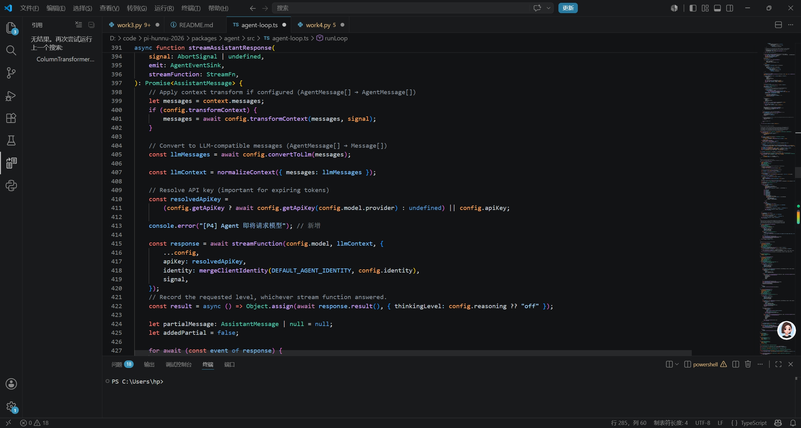
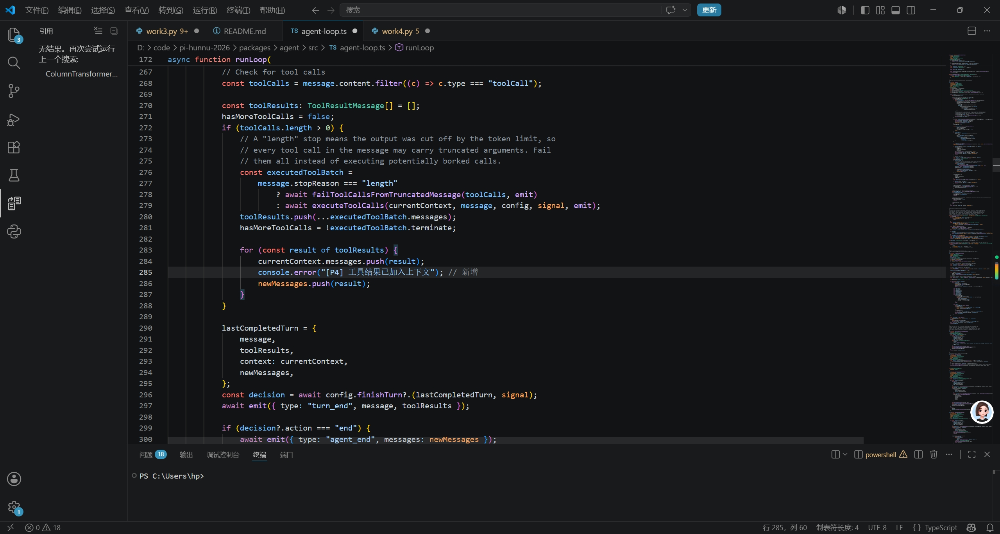
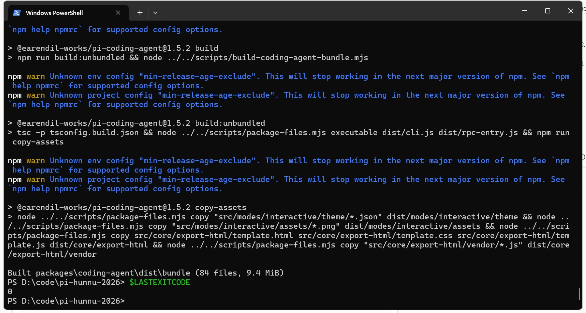
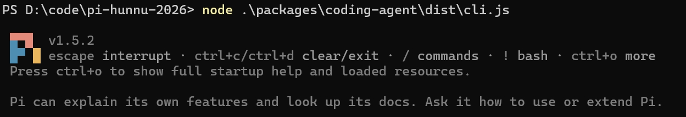
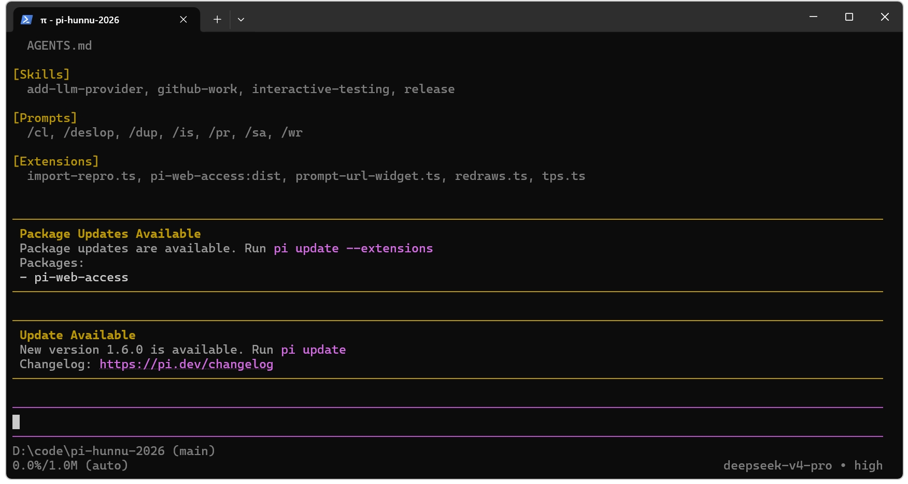
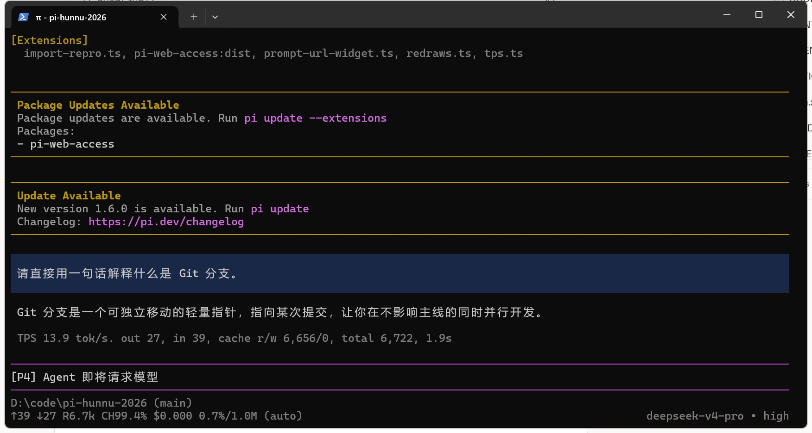
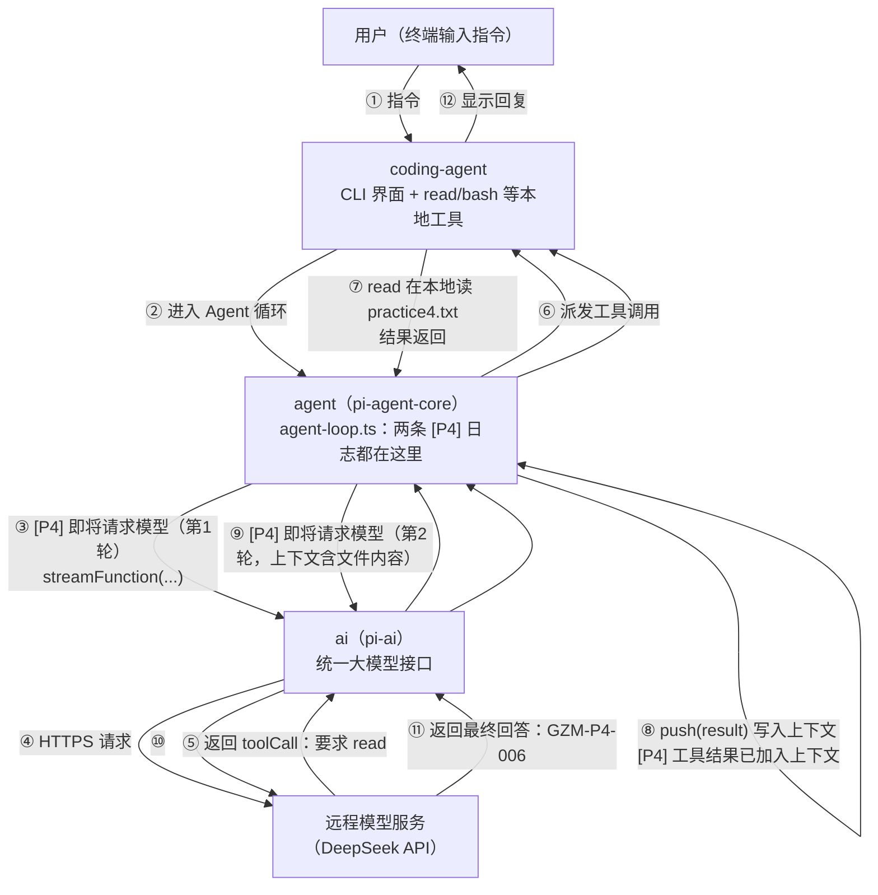

# 实践课4：Pi Agent 的模型调用与运行流程实践报告

## 基本信息

| 项目 | 内容 |
|---|---|
| 姓名 | 国梓濛 |
| 学号 | 202430224006 |
| GitHub 登录名 | sakgratama-collab |
| 所在小组 | 第 13 组（组织：Wolf-F4） |
| 源码仓库 | https://github.com/Wolf-F4/pi-hunnu-2026 （提交 `c3cc91632d0a1950fb122605b190233f2aa0006e`） |
| 实验代号 | GZM-P4-006（写入 `practice4.txt`） |

---

## 一、源码修改：给 Agent 循环加两行日志

**修改 1 —— 模型调用前打印日志** ：

```ts
	console.error("[P4] Agent 即将请求模型"); // 新增

	const response = await streamFunction(config.model, llmContext, {
```

每次 Agent 把当前上下文交给模型调用函数之前，都会先执行到这一行。



**修改 2 —— 工具结果加入上下文后打印日志** ：

```ts
				for (const result of toolResults) {
					currentContext.messages.push(result);
					console.error("[P4] 工具结果已加入上下文"); // 新增
					newMessages.push(result);
				}
```

日志写在 `for` 循环体内，每向上下文写入一条工具结果就打印一次。



两处均使用 `console.error`，日志走标准错误流，不会混进程序的正常输出数据。

## 二、重新编译并启动

保存源码后，在仓库根目录执行 `npm run build` 重新编译。构建日志按既定顺序走完 11 个子包，`pi-agent-core` 一环的 `tsc` 编译通过，说明新增两行语法正确；最终输出 `Built packages\coding-agent\dist\bundle (84 files, 9.4 MiB)`，随后 `$LASTEXITCODE` 为 `0`。



启动编译产物 ：

```powershell
node .\packages\coding-agent\dist\cli.js
```





## 三、对比两次运行

实验准备：在项目根目录创建 `practice4.txt`，写入一行 `实验代号：GZM-P4-006`。两次会话使用同一模型（deepseek-v4-pro），各自在全新会话中进行。

### 会话 A：直接问答

- **输入指令**：请直接用一句话解释什么是 Git 分支。
- **是否调用工具**：否。界面上没有出现任何工具执行记录。
- **实际出现的 [P4] 日志** ：

```text
[P4] Agent 即将请求模型
```

共 1 条，"工具结果已加入上下文"日志 0 条。

- **最终回复**："Git 分支是一个可独立移动的轻量指针，指向某次提交，让你在不影响主线的同时并行开发。"（统计：out 27 / in 39，1.9s）
- **结论**：直接问答只进入了 **1 轮模型调用**——模型凭自身知识即可回答，循环没有进入工具执行分支。



### 会话 B：读取文件

- **输入指令**：请用 `read` 工具读取当前目录的 `practice4.txt`，并告诉我文件中的实验代号。
- **是否调用工具**：是。模型先回复 "Let me read the file practice4.txt in the current directory."，随后界面出现绿色的 `read practice4.txt` 工具执行记录。
- **实际出现的 [P4] 日志** ：

```text
[P4] 工具结果已加入上下文       ← read 的结果（文件内容）写入上下文
[P4] Agent 即将请求模型        ← 第 2 轮：模型带着文件内容被再次调用
```

- **最终回复**："文件中的实验代号是：GZM-P4-006"——与我写入文件的代号完全一致，证明 Pi 真实读到了文件内容。（统计：out 105 / in 86，3.0s）
- **结论**：读取文件的会话进入了 **2 轮模型调用**，中间夹着一次本地工具执行。

![S6：会话 B 的指令、read 工具记录、读出的实验代号与循环后半段的两条 [P4] 日志](images/s6-session-b.png)

### 两次会话对比

| 对比项 | 会话 A（直接问答） | 会话 B（读取文件） |
|---|---|---|
| 是否调用工具 | 否 | 是（read 一次） |
| "工具结果已加入上下文"次数 | 0 | 1 |
| 模型调用轮数 | 1 轮 | 2 轮 |
| 上下文变化 | 只有用户问题 | 第 2 轮多了 read 的工具结果消息 |

### 回答作业问题

**谁实际读了文件？** 不是远程模型。模型只是在第 1 轮的回复里发出了"调用 read 工具"的请求（toolCall）；真正打开并读取 `practice4.txt` 的是本地 coding-agent 进程中的 read 工具（`packages/coding-agent/src/core/tools/read.ts`），文件内容始终在我的电脑上被读取。

**下一轮模型请求多带了什么？** 多带了工具结果消息。对应源码就是我加日志的位置：`currentContext.messages.push(result)` 把 read 返回的文件内容作为一条消息追加进上下文，紧接着打印"[P4] 工具结果已加入上下文"；随后循环回到模型调用处，打印"[P4] Agent 即将请求模型"，把**包含文件内容在内**的完整上下文再次交给 `streamFunction` 发往模型。这也解释了统计中第 2 轮输入 token 变多的现象——模型是"看了文件内容才答出代号"的。

### 运行流程简图

下图标出 coding-agent、`agent`、`ai` 与远程模型服务四个参与者，编号为会话 B 的实际执行顺序（箭头表示调用/数据流向）：



分层对应前几次实践课的分析：coding-agent 提供界面与本地工具，`agent` 掌管"模型调用 ↔ 工具执行"的循环，`ai` 负责把请求翻译成具体厂商的 API，远程模型服务只负责推理——文件 I/O 永远发生在本地。

## 四、遇到的问题与解决

1. **改完源码忘记保存，日志不出现**。第一次重编译并运行会话 A 后，终端里完全找不到 `[P4]` 日志。排查发现 VS Code 标签页上还有未保存的圆点标记——编译的仍是旧代码。按 `Ctrl+S` 保存后重新构建，日志正常出现。教训：构建前先看编辑器的未保存标记，"编译的是磁盘上的文件，不是编辑器里的画面"。
2. **重编译改用 build:offline 提速**。第二次构建时使用实践课 3 学到的 `npm run build:offline`，复用上次已生成的模型目录数据，跳过联网抓取环节，构建明显变快，退出码同样为 0。

## 五、心得体会

两行日志像给 Agent 循环装了两个"探针"，把抽象的运行流程变成了可观察的事实：会话 A 证明没有工具参与时循环一轮就结束；会话 B 证明"模型请求 → 工具执行 → 结果回填 → 再次请求"的完整回路——模型自己不碰文件，真正做的是本地工具。结合实践课 2 的模块分析，这次终于在运行时亲眼验证了 coding-agent、agent、ai 三层的分工。另外"忘记保存导致日志消失"也让我对"源码 → 构建产物"的关系有了更扎实的体感：dist 里跑的永远是上次构建时的代码。

---
