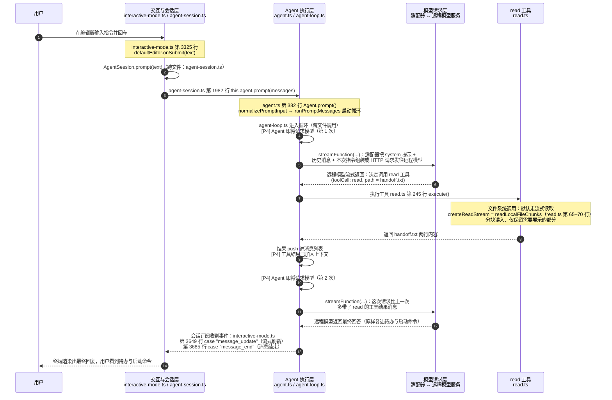
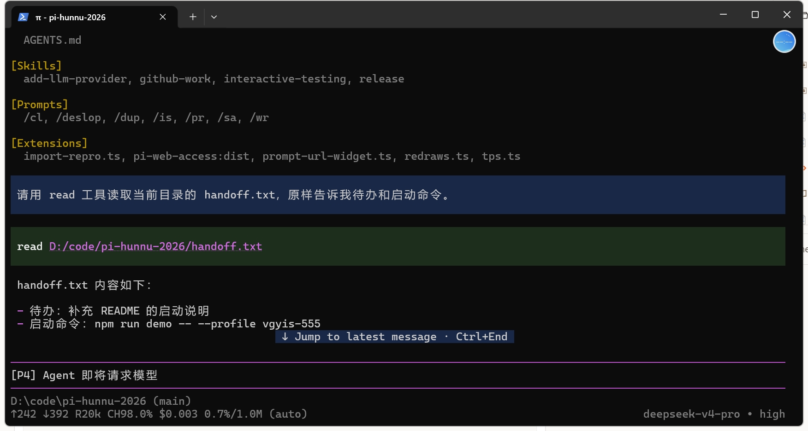
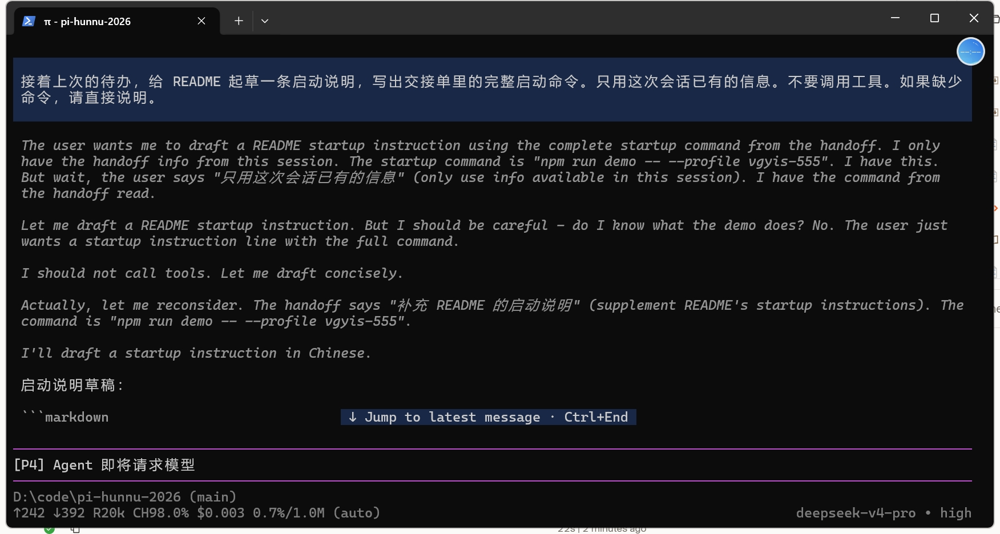
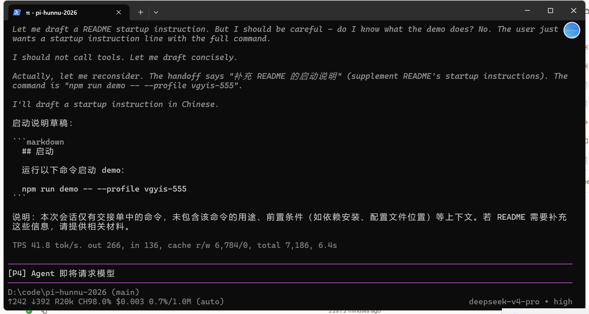
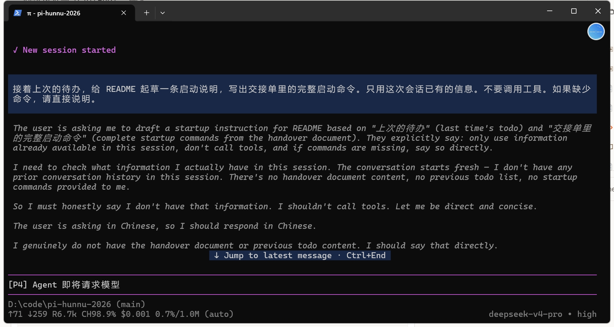
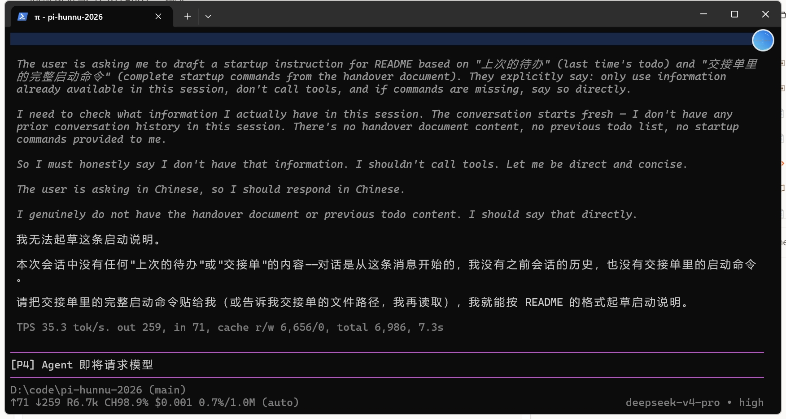
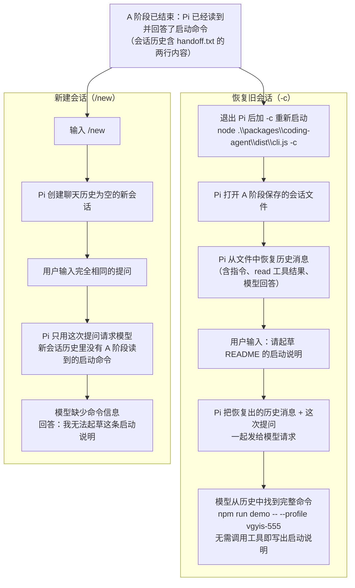

# 实践课 5 报告：Pi Agent 工具调用与会话恢复

## 基本信息

| 项目 | 内容 |
| --- | --- |
| 姓名 | 国梓濛 |
| 学号 | 202430224006 |
| GitHub 登录名 | sakgratama-collab |
| 小组仓库 | https://github.com/Wolf-F4/pi-hunnu-2026 |
| 实验环境 | Windows + PowerShell，Pi 源码版 v1.5.2（本地构建，含实践 4 添加的 [P4] 日志），模型 deepseek-v4-pro |

---

## A. 单轮交互与工具调用

### 准备交接单

在项目根目录 `D:\code\pi-hunnu-2026` 用 PowerShell 随机生成标识并写入 `handoff.txt` 两行：

```text
待办：补充 README 的启动说明
启动命令：npm run demo -- --profile vgyis-555
```

### 实验过程与观察

以 `node .\packages\coding-agent\dist\cli.js` 启动本地构建的 Pi，新会话中输入：

> 请用 read 工具读取当前目录的 handoff.txt，原样告诉我待办和启动命令。

实际观察到：

- 界面出现绿色的工具执行记录 `read D:/code/pi-hunnu-2026/handoff.txt`，即本轮**确实发生了一次 read 工具调用**；
- Pi 原样复述了两行内容，启动命令中的标识 `vgyis-555` 与文件完全一致；
- 终端中出现实践 4 添加的 `[P4]` 日志：`[P4] 工具结果已加入上下文` → `[P4] Agent 即将请求模型`。完整顺序为：请求模型 → 执行 read 工具并把结果加入上下文 → 再次请求模型。即**一轮交互、两次模型调用、一次工具执行**；
- 统计信息：out 126 / in 106，3.9s。

![S1：A 阶段——指令、read 工具记录、原样复述的两行内容与 [P4] 日志](images/s1-stage-a.png)

### 图 1：单轮工具调用的代码级时序图

下图以上面实际读取 `handoff.txt` 的这一轮为例，按职责分为五条生命线。箭头上标注的均为源码中的真实函数或语句。



源码核对说明：

- **输入入口**：`interactive-mode.ts` 第 3325 行把编辑器的 `onSubmit` 设为处理用户输入的回调，指令由此进入会话层。
- **启动循环**：会话层 `agent-session.ts` 第 1982 行调用 `this.agent.prompt(messages)`；`agent.ts` 第 382 行的 `Agent.prompt()` 经 `normalizePromptInput` 规范化后调用 `runPromptMessages` 启动 agent 循环（循环主体在 `agent-loop.ts`，即实践 4 插入 [P4] 日志的位置）。
- **模型与文件边界**：模型请求层中，适配器负责把消息列表组装成请求发给远程模型服务并接收流式响应；文件系统调用只发生在 read 工具内部。核对 `read.ts` 第 55–70 行：默认实现同时提供 `readFile`（缓冲区整读）和 `createReadStream = readLocalFileChunks`（流式分块），注释说明当提供流式接口时按块读取、仅在内存中保留将要展示的部分，**实际走的是流式读取**。
- **显示回复**：`interactive-mode.ts` 第 3649 行 `case "message_update"` 处理流式片段刷新、第 3685 行 `case "message_end"` 处理消息结束——用户在终端看到回复的位置就在这两个分支。

---

## B. 恢复上次会话，继续写 README

A 阶段结束后退出 Pi，分别用两种方式重新进入，输入**完全相同**的一段话：

> 接着上次的待办，给 README 起草一条启动说明，写出交接单里的完整启动命令。只用这次会话已有的信息。不要调用工具。如果缺少命令，请直接说明。

### B-1 恢复原会话（-c）

用 `node .\packages\coding-agent\dist\cli.js -c` 重新启动。终端首先回放出 A 阶段的完整聊天记录（提问、绿色 read 记录、handoff.txt 两行内容），确认历史已恢复：



输入上述指令后，模型的思考过程明确写道："The startup command is npm run demo -- --profile vgyis-555. I have this." 以及 "I should not call tools."——命令直接来自恢复出的会话历史：



最终回答起草了 README 启动说明，**完整写出了 `npm run demo -- --profile vgyis-555`，且全程没有出现任何工具执行记录**（统计：out 266 / in 136，6.4s）：



### B-2 新建会话（/new）

不退出 Pi，输入 `/new` 开始新会话（界面显示 `√ New session started`），发送完全相同的指令。模型思考过程写道："The conversation starts fresh — I don't have any prior conversation history in this session… no startup commands provided to me." 并遵守"不要调用工具"：



最终回答是：**"我无法起草这条启动说明。"**——明确说明本次会话没有"上次的待办"或"交接单"的内容，也没有启动命令，请用户提供（统计：out 259 / in 71，7.3s）。没有调用任何工具：



### 两次对照记录

| 对比项 | B-1 恢复会话（-c） | B-2 新会话（/new） |
| --- | --- | --- |
| 启动方式 | `node .\packages\coding-agent\dist\cli.js -c` | 会话内 `/new` |
| 界面是否出现 A 阶段历史 | 是，完整回放 | 否，空白新会话 |
| 是否调用工具 | 否 | 否 |
| 回答是否含完整启动命令 | 是：`npm run demo -- --profile vgyis-555` | 否：直接说明缺少命令 |
| 发送给模型的输入规模 | ↑242（含恢复的历史消息） | ↑71（只有本次提问） |

恢复会话的回答包含了 A 阶段读到的完整命令、且没有重新读文件，证明它使用的是**已恢复的会话历史**；新会话因历史为空而如实报告缺命令。两次输入 token 的差距（242 对 71）也直接印证了两种情况下发给模型的消息集合不同。

### 图 2：恢复旧会话与新建会话的对照图



---

## 心得

这次实验把"会话"这个概念落到了代码层面：`-c` 恢复的本质不是模型"记性好"，而是 Pi 把会话文件里的历史消息重新装进消息列表、随新提问一起发给模型；`/new` 则从一个空列表出发，模型自然"失忆"。B-1 与 B-2 输入 token 的悬殊（242 对 71）让这一点一目了然。结合图 1 的时序，整条链路——编辑器 onSubmit 收下输入、Agent.prompt 启动循环、适配器往返远程模型、read 工具流式读文件、message_update/message_end 把回复画到屏幕上——都能在源码里找到对应的函数，Pi 不再是黑盒。

---